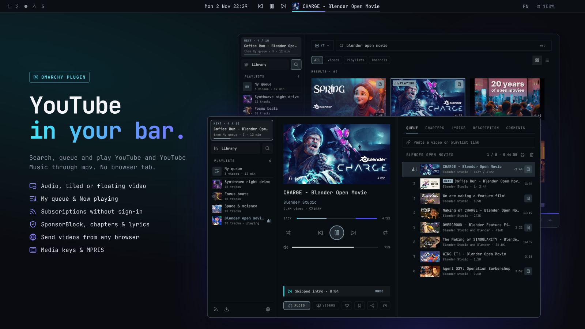
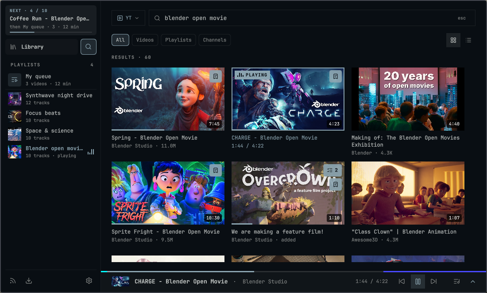
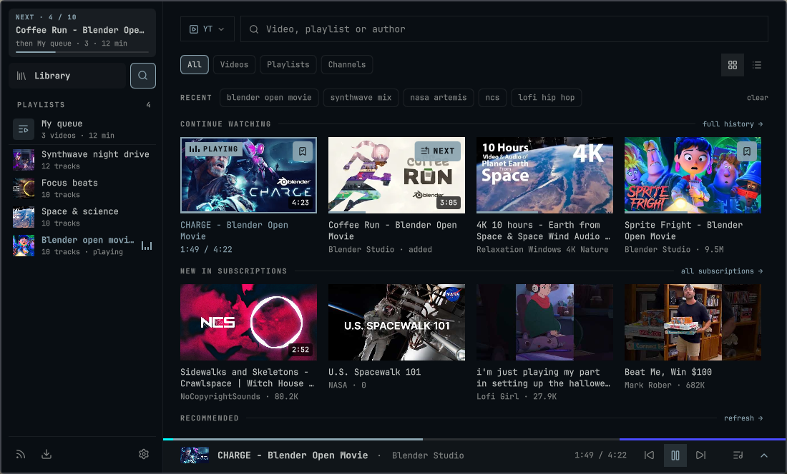
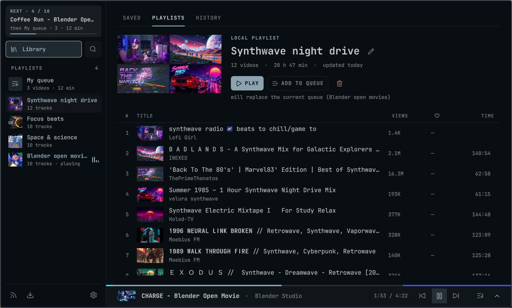
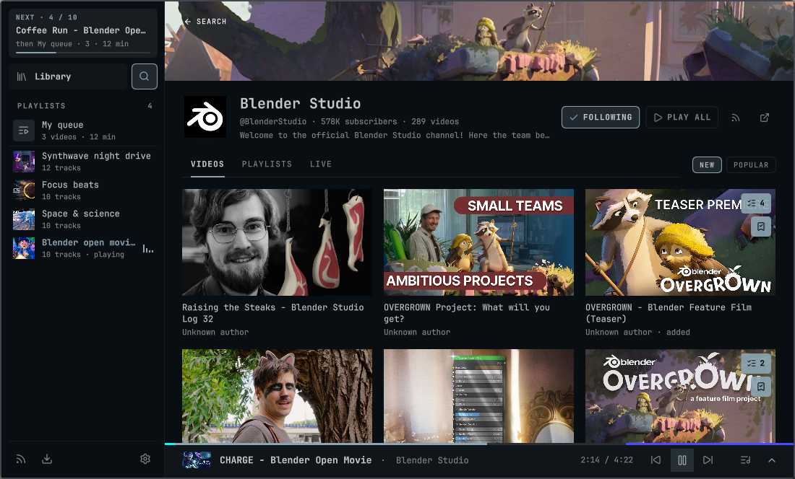
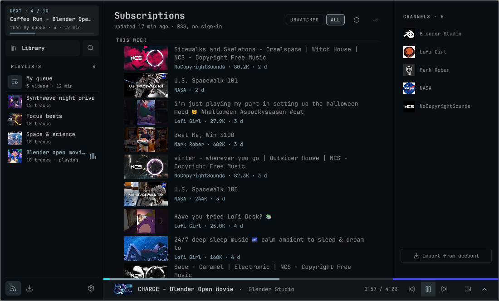
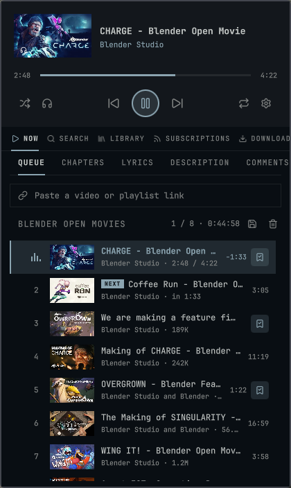

<!-- markdownlint-disable MD013 MD033 -->

# OmaTube

[](https://github.com/vornashev/OmaTube/releases/latest)
[](https://github.com/vornashev/OmaTube/actions/workflows/ci.yml)
[](LICENSE)

YouTube and YouTube Music in your [Omarchy](https://omarchy.org/) bar. OmaTube is an Omarchy Shell widget backed by a local Python service and mpv: search, queue and play audio or video with no browser tab open.

**English** · [Русский](README.ru.md)

<p align="center"></p>

<table>
  <tr>
    <td></td>
    <td></td>
  </tr>
  <tr>
    <td></td>
    <td></td>
  </tr>
  <tr>
    <td></td>
    <td align="center"></td>
  </tr>
</table>

<sub>Shown: Blender Studio open movies (CC BY), NASA and NoCopyrightSounds.</sub>

## Features

- **Search and browse** YouTube and YouTube Music: videos, tracks, playlists, albums, channels and artists.
- **Audio, tiled video or floating video** through mpv, with quality up to 2160p, speed, sleep timer and loudness normalization.
- **Two queues.** Single videos go to *My queue*. Playlists, albums and radio play in *Now playing*. An interrupted playlist resumes from the same track and second.
- **Library:** saved media, editable playlists, copies of public playlists, history, listening statistics and saved queue sessions.
- **Subscriptions without an account:** an RSS feed of the channels you follow, or import your subscriptions from a signed-in account.
- **SponsorBlock**, chapters, synced lyrics (LRCLIB), comments and storyboard previews on the timeline.
- **Downloads** of audio (Opus) or video (MP4) to `~/Videos/OmaTube`.
- **“Watch in OmaTube” browser extension** for Chromium, Chrome, Brave, Vivaldi, Edge, Opera, Firefox, Zen, LibreWolf and more. It moves a YouTube tab to OmaTube at the same moment.
- **Wide, compact and shelf layouts**, a configurable bar widget and MPRIS media controls.
- **English and Russian** interface; the language follows the system locale.

## Requirements

Omarchy with Omarchy Shell. Nothing else: Python, mpv, ffmpeg and jq ship with Omarchy, and the plugin fetches the rest (yt-dlp, Deno, youtubei.js) at pinned versions with checksums.

## Installation

```bash
omarchy plugin add https://github.com/vornashev/OmaTube.git --enable
```

On first load, the plugin creates its own Python environment under `~/.local/share/omatube`, sets up the `omatube` command and starts the backend. You don't need sudo. The first start takes a minute while dependencies download.

The backend is a regular user process, started by the widget or the browser extension when they need it. It keeps playing when the shell restarts and stops when you log out. The catalog worker runs in Deno's permission sandbox: network access and one scratch directory, nothing else.

Then open the widget in the bar. The onboarding screen offers to connect your YouTube account. This is optional and imports cookies from Chromium.

### Updating

```bash
omarchy plugin update vornashev.omatube
```

Your library and settings are kept. After an update, press **Reload** on the extension card in `chrome://extensions`, if you use the browser extension. See [CHANGELOG.md](CHANGELOG.md) for what changed.

### Uninstalling

```bash
~/.config/omarchy/plugins/vornashev.omatube/uninstall.sh          # keep library and settings
~/.config/omarchy/plugins/vornashev.omatube/uninstall.sh --purge  # remove everything
```

Use this script rather than `omarchy plugin remove`: the script also stops the backend and unregisters the browser bridge.

## Usage

Click the widget to open the panel. Pressing Play on a single video puts it at the head of **My queue** and starts it. Whatever was playing moves to second place and later resumes where it stopped. Playing a playlist, album, radio or **Play all** fills **Now playing**. When My queue runs out, a paused playlist continues from the same track and second.

The `omatube` command talks to the backend:

```bash
omatube status                     # playback state as JSON
omatube details                    # full state: queue, library, preferences
omatube request '{"command":"play_url","url":"https://youtu.be/VIDEO_ID"}'
omatube browser-status             # browser bridge per browser
omatube browser-setup              # (re)register the browser bridge
```

## Browser extension

The bundled extension adds a **Watch in OmaTube** button to YouTube, Shorts and YouTube Music. It also adds a hover button on thumbnails, an `Alt+Shift+O` shortcut and a link context-menu item. Videos already in your OmaTube queue are marked on YouTube thumbnails.

Quick start for Chromium-based browsers: open `chrome://extensions`, enable **Developer mode**, click **Load unpacked** and choose `~/.local/share/omatube/browser-extension`.

For Firefox and its forks, other browsers, settings and how the bridge works, see [docs/browser-extension.md](docs/browser-extension.md).

## Privacy

OmaTube has no telemetry and no account of its own. Everything stays on your machine:

- **Library, history and playback state:** `~/.local/share/omatube` (SQLite)
- **Preferences and imported cookies:** `~/.config/omatube` (mode `0600`). Cookies are filtered to YouTube domains.
- **Thumbnail cache:** `~/.local/share/omatube/cache/images` (up to 256 MB)

Network requests go to YouTube (`youtube.com`, `i.ytimg.com`, `yt3.ggpht.com`), SponsorBlock (`sponsor.ajay.app`) and LRCLIB (`lrclib.net`) only. The backend listens on a Unix socket and on a loopback-only image cache at `127.0.0.1:47865`, which serves thumbnails from allow-listed hosts only. The browser extension uses native messaging and opens no port.

## Troubleshooting

| Symptom | What to try |
| --- | --- |
| Widget says the backend is unavailable | `omatube logs`, then `omatube restart` |
| Videos stop playing or search breaks for everyone | YouTube changed something; update with `omarchy plugin update vornashev.omatube` and check for a newer release |
| YouTube is blocked on your network | Put a proxy URL such as `http://127.0.0.1:7897` in `~/.config/omatube/proxy`, then run `omatube restart` |
| Age-restricted or members-only video fails | Connect your account in Settings → Account (imports Chromium cookies) |
| Extension says “not connected” | `omatube browser-status`, then `omatube browser-setup`, then reload the extension |
| Something else | [Open an issue](https://github.com/vornashev/OmaTube/issues/new/choose) with the output of `omatube status` |

## Contributing

Bug reports and pull requests are welcome. See [CONTRIBUTING.md](CONTRIBUTING.md) and [docs/development.md](docs/development.md) for setup, tests and the release process.

## Disclaimer

OmaTube is an independent project. It is not affiliated with, endorsed by or sponsored by Google or YouTube. YouTube is a trademark of Google LLC. Use OmaTube in line with YouTube's Terms of Service.

## License

[MIT](LICENSE) © 2026 Artem Vornashev
